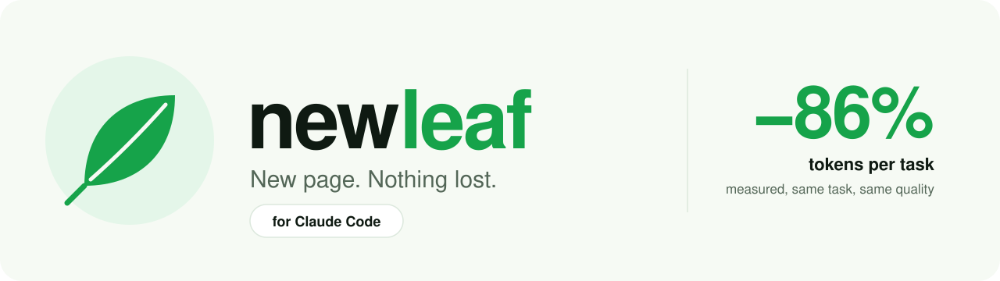
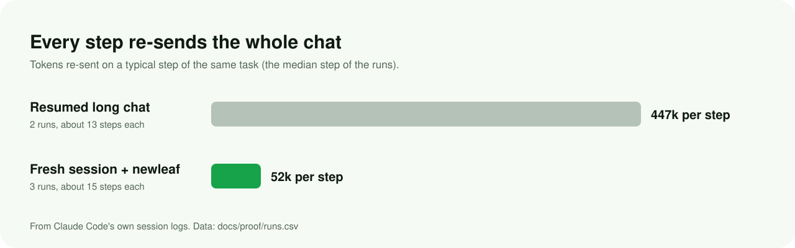
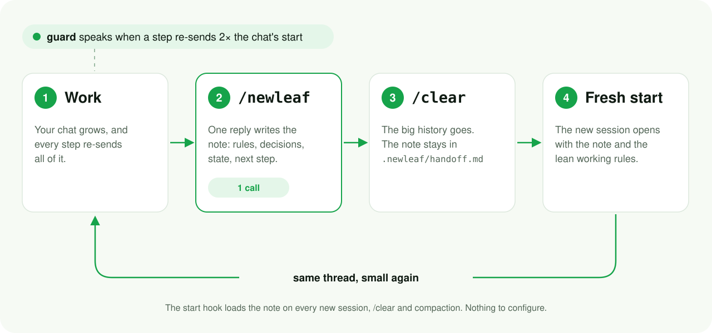
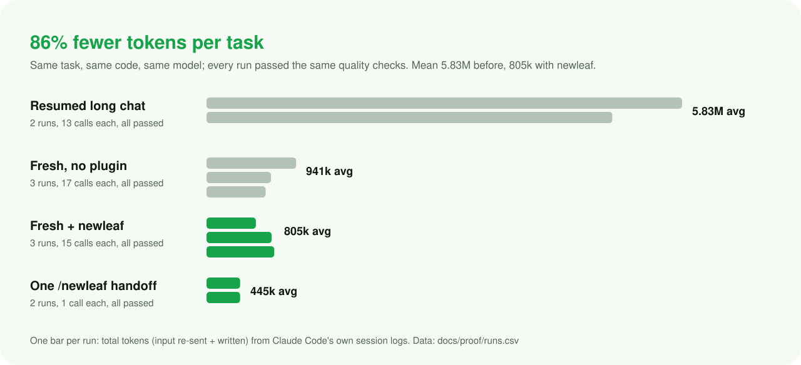

<p align="center">
  
</p>

<p align="center">
  <b>Fresh Claude Code sessions that keep the thread.</b><br>
  A one-call handoff note, loaded into your next session automatically,<br>
  and a guard that tells you when a chat has grown costly.
</p>

<p align="center">
  <a href="https://github.com/zannn123/newleaf/actions/workflows/tests.yml"></a>
  
  
  <a href="LICENSE"></a>
</p>

<p align="center"><a href="docs/newleaf-guide.pdf"><b>Read the 6-page guide (PDF)</b></a> · <a href="docs/proof">How it was measured</a></p>

---

## Why your limits burn

Every step of a Claude Code session re-sends the whole conversation. Keep one
session going for days and each step re-sends hundreds of thousands of tokens,
so even a one-line change costs millions. Shorter replies don't fix it: in the
14 days of logs we measured (8,030 API calls), replies were **0.3%** of all
tokens and **99%** was the conversation being re-sent.

newleaf makes starting fresh safe, so you can do it often.

<p align="center"></p>

## Install

```bash
claude plugin marketplace add zannn123/newleaf
claude plugin install newleaf@newleaf
```

Or inside Claude Code: `/plugin marketplace add zannn123/newleaf`, then
`/plugin install newleaf@newleaf`. That's all. It works in every project, from
any terminal (PowerShell, cmd, bash, your IDE).

**Needs:** bash. Built in on macOS, Linux and WSL; on Windows it comes with
[Git for Windows](https://git-scm.com/downloads/win), which Claude Code
recommends anyway. No Python, no Node, no network.

### Codex (experimental)

The same repo is also a Codex plugin: a Codex manifest (`.codex-plugin/`)
with the hooks in Codex's own schema, and Codex reads this repo's marketplace
file.

```bash
codex plugin marketplace add zannn123/newleaf
codex plugin add newleaf@newleaf
```

Or add it in the Codex desktop app. Then run `/hooks` once to trust newleaf's
hooks (Codex asks this for every plugin hook), start a new session, and use
**`$newleaf`**, then **`/new`**.

Status: built from Codex's official docs and its source code; the hook scripts
are the ones tested above, plus tests against Codex's log format. It has not
yet been measured in a live Codex session, and Codex on Windows is untested.

## Use

1. Work as usual.
2. When a round of work ends, or newleaf says the chat has grown, type **`/newleaf`**.
3. Type **`/clear`**. The fresh session starts with your note and the lean working rules.

<p align="center"></p>

## How it works

| Piece | What it does |
| --- | --- |
| `/newleaf` | One reply writes the handoff note: rules in play, decisions and why, state, the next step, open questions. Git facts are gathered before the model reads the skill, so it costs **one call**. |
| Stop hook | Saves the note to `.newleaf/handoff.md` (the old one becomes `handoff.prev.md`). The folder hides itself from git. |
| Start hook | Loads the lean working rules and the note into every new session, `/clear` and compaction, and says if the repo moved on since the note. |
| Guard | Says so when a step re-sends **twice** what the chat started with, then again at 4× and 8×. A handoff costs one call, so past 2× it pays for itself within your next request. |

Three short bash scripts you can read in a minute: [`hooks/`](hooks). No
telemetry; nothing leaves your machine.

## Proof

Measured on 2026-10-31 on a real production Flutter codebase: the same task
(restyle a split button), the same code, the same model (Claude Opus), tokens
read from Claude Code's own session logs. Every run passed the same checks: the
project's 97 report tests, the analyzer, no hard-coded colour, changes only in
the feature's folder.

<p align="center"></p>

| | Runs | Tokens per task | Calls | Re-sent per call | Quality |
| --- | --- | --- | --- | --- | --- |
| Resumed long chat (before) | 2 | 5.83M | 13 | 447k | 2 / 2 pass |
| Fresh session, no plugin | 3 | 941k | 17 | 57k | 3 / 3 pass |
| **Fresh session + newleaf** | 3 | **805k** | 15 | 52k | **3 / 3 pass** |
| One `/newleaf` handoff | 2 | 445k | 1 | 441k | 2 / 2 complete notes |

- **86% fewer tokens per task.**
- **79% fewer** on the first task even counting the handoff; **85%** over five tasks.

Method, data and how to re-draw the charts: [`docs/proof`](docs/proof). Your
numbers will differ with your project and habits; measure your own with
`python tools/measure.py --days 7` (optional, needs Python).

## Settings

Optional. `~/.claude/newleaf.json` for your machine, or
`.newleaf/config.json` in a project (the project wins).

| Key | Default | Meaning |
| --- | --- | --- |
| `rules` | `true` | `false` leaves out the lean working rules. |
| `warn_at` | 2× the chat's first step | Tokens per step that wake the guard. `0` turns it off. |

## FAQ

**Does it work with caveman?** Yes, they add up. caveman shortens replies,
about 0.3% of tokens; newleaf cuts the re-sent conversation, about 99%.

**Where is my note?** `.newleaf/handoff.md` in your project, the previous one
in `handoff.prev.md`. git ignores the folder on its own.

**Does it run on my machine?** Tested on Windows 11 (Git Bash), Ubuntu, Debian
(mawk), Alpine (busybox awk) and macOS (CI): [`tests/hooks.sh`](tests/hooks.sh)
covers every hook, [`tests/smoke.sh`](tests/smoke.sh) runs it end to end with
real Claude Code.

**Is anything sent anywhere?** No. The hooks read your local session log and
write `.newleaf/` in your project.

## Uninstall

```bash
claude plugin uninstall newleaf
claude plugin marketplace remove newleaf
```

## License

[MIT](LICENSE)
